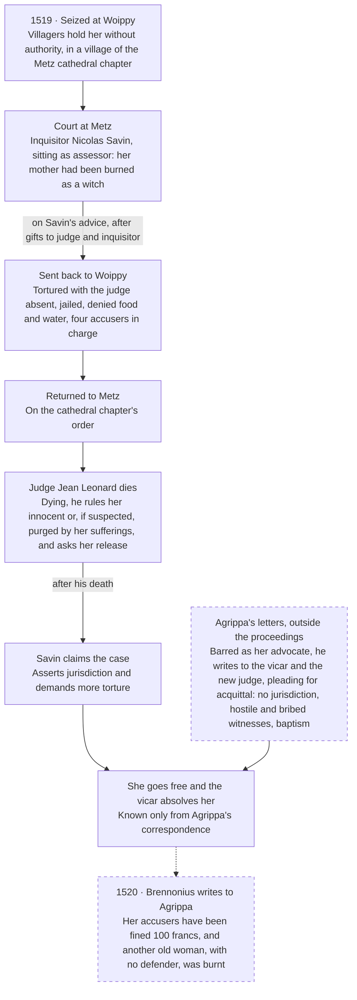

# Agrippa at Metz, 1519: A Witch(x) Case Study

**Prepared:** 18 October 2026, by Claude (Anthropic) at the author's request  
**Manuscript read:** `JosiahAlanLee/Librum_Quinque` at commit `eb2eeaf`; book locations re-keyed to this repository at `6df7ad3`  
**Status:** research for review; no manuscript changes made

Metz in 1519 is a real proceeding with a full cast: an accused woman, an inquisitor, two judges, a cathedral chapter and an advocate. It closes two of the five gaps in the [blame register](blame-register.md#gaps-the-register-shows) (a real incident, a witch) and narrows two (the demand side, the line between accountability and scapegoating). The fifth, the link between false report and the no-fault exit, is in the record: when she went free, her accusers were fined, though the two readers of that letter disagree about what for.

Its record is the advocate's own: Agrippa's letters, the letters he kept from Metz, and his later polemic, read here through [Hoorens and Renders (2012)](https://hansrendersarchive.org/wp-content/uploads/2023/10/sixteenth-century-renders.pdf) and two biographers who worked from the Latin, Morley (1856) and Prost (1881). Hoorens and Renders set the case's limit: Agrippa contested an inference and a procedure, not the category, and his *De vanitate* has the most pernicious witches deserving the fire.

## The case

The sequence follows Hoorens and Renders's reconstruction, with details from Morley's and Prost's readings of the same letters marked. Letter numbers are those of Agrippa's *Opera* (Lyon, c. 1600), as both biographers cite them. No court record was opened for this study.

1. **1518.** Agrippa becomes legal adviser and orator to the magistrate of Metz, a free imperial city ([SEP](https://plato.stanford.edu/entries/agrippa-nettesheim/); Hoorens and Renders).
2. **1519.** Villagers of Woippy seize a woman at night and hold her without any authority (Morley; Prost). The village belonged to the cathedral chapter (Prost; [Geneawiki](https://fr.geneawiki.com/wiki/57751_-_Woippy)). No source opened here names her.
3. The chapter has her brought to Metz for trial before the official of the bishop's court. The villagers are given a term to choose between accusing her and merely denouncing her. Eight come forward as accusers and are ordered to give pledges of good faith (Morley) or to hold themselves prisoner (Prost).
4. The Dominican inquisitor Nicolas Savin (Savini in older accounts) sits on the court as assessor. The first article against her is that her mother had been burned as a witch (Ep. II.38, in Morley). In Agrippa's later telling Savin cited the *Malleus*: her mother must have dedicated her to the devil ([Dresen-Coenders](https://dbnl.org/tekst/dres005verb01_01/dres005verb01_01_0012.php)).
5. During a two-day adjournment, Agrippa writes, the inquisitor took eggs, butter and cakes and the judge gold pieces (Morley); Prost has the judge hand her to her accusers for a few florins. On Savin's advice she is sent back to Woippy in the hands of four accusers, without Agrippa's knowledge. The other four had been rejected as notorious ruffians.
6. At Woippy she is tortured with the judge absent, jailed and denied food and water, while her accusers go free (Morley).
7. Agrippa, who had taken up her defense, petitions the vicar, probably Conrad Le Payen: Savin has no jurisdiction without manifest heresy, Woippy is a suspect place, and in such cases the defense is not admitted (Ep. II.38).
8. The Metz chapter orders her returned to the city.
9. The judge, Jean Leonard, falls ill. Dying, he sends Savin by a notary a written judgment that she is innocent or, if suspected, purged of offence by her sufferings, and to be set free (Morley).
10. Savin claims jurisdiction and demands her for further torture and the fire (Morley).
11. Agrippa petitions the new judge, citing his predecessor's remorse and ruling, and pleads for acquittal (Ep. II.39).
12. The chapter shuts Savin out of the case, and she goes free. Morley has the vicar absolve her and Prost has him declare her innocent, both reading Agrippa's letter to Cantiuncula (Ep. II.40). Hoorens and Renders credit the new judge.
13. **1520.** Agrippa leaves Metz early in the year (Prost), after quarrels with the monks over this case and over St. Anne's three marriages ([Wikipedia](https://en.wikipedia.org/wiki/Heinrich_Cornelius_Agrippa); [Barrett](https://sacred-texts.com/grim/magus/ma262.htm)).
14. Brennonius, curé of Sainte-Croix in Metz, writes to him that her enemies have been fined a hundred francs (Ep. II.46) and that she visits with small presents in Agrippa's memory (Ep. II.53). Morley gives the fine's ground as unjust accusation of the innocent; Prost, as holding her without a judge's licence or their lords' commission.
15. Brennonius also reports Savin torturing an old woman into confessing flight, storms and harm to men and cattle, and having her burnt. It was her lot, he writes, “in her innocence to want a defender.” Savin announced the charges to a public assembly, and villagers seized more old women, most of whom fled (Ep. II.59, in Morley).
16. **1526–1534.** Agrippa tells the case in *De vanitate*, ch. 96, announced in September 1526 and printed at Antwerp in 1530 (SEP). The full letters appear with his treatise on St. Anne's single marriage (1534).

## The route

Metz and Woippy, 1519–20, as reconstructed from Agrippa's correspondence. Dashed boxes are letters from outside the proceedings.

The defense entered from outside the proceedings, by letter. The release followed a change of judge, the accusers were fined, and after the advocate left the inquisitor had another woman burnt.

## The record and its dependence

Everything about the case reaches us through Agrippa's correspondence: his letters during it, his friend's letters after it, and his own later retelling. No record outside it was found. On 18 October, Brulé's study of Metz witchcraft could be reached only as a catalogue entry, Litzenburger's chapter on Metz witch trials not at all, and Vigneulles's chronicle of the city only to 1504. Two outside sources confirm the frame of the case, not the case.

| Source | Written by, when | Adds | Independent of Agrippa? |
| --- | --- | --- | --- |
| Petitions to the vicar and the new judge (Ep. II.38–39); letters to Claudius Cantiuncula (II.40) and to Henricus, an imperial counselor in Luxembourg | Agrippa, 1519, during the case | The procedure, the judges, the gifts, Savin's claims, Agrippa's arguments, the witness list | No. Not opened here; read through Hoorens and Renders, Morley and Prost. *Opera*, vol. 2, pp. 752–57; printed in full with *De beatissimae Annae monogamia* (1534) |
| *De vanitate*, ch. 96, “Of the Inquisitoures Arte” in the 1569 English | Agrippa; announced 1526, printed 1530 | The *Malleus* argument, the baptism retort, mockery of incubi, an attack on the Dominicans | No. Read through Dresen-Coenders (1983) and Hoorens and Renders; the chapter title from [Cornell's record](https://digital.library.cornell.edu/catalog/witchcraft005) of the 1569 English |
| Letters to Agrippa after he left, Ep. II.46, 53 and 59 among them | Johannes Brennonius, curé of Sainte-Croix, Agrippa's friend; from 1520 | The fine and its ground; her visits; “saved from the stake”; Savin's later case, ending at the stake | Partly: a second witness, but a friend, and kept in Agrippa's correspondence (*Opera*, vol. 2, pp. 763–78) |
| An early-modern apologia for Agrippa, unidentified; Barrett, *The Magus* (1801) | Defenders of his reputation | Accusers and witnesses heavily fined; a principal accuser called “Messin”; torture Agrippa could not prevent | Dependent and later. The fines come from Ep. II.46; the witnesses' share and “Messin” are in no reading of the letters opened here. The apologia was read in [an AI translation](https://sourcelibrary.org/book/69c879e06c6f3cc53c858579/page-number/-107) whose pages do not identify the book |
| [SEP](https://plato.stanford.edu/entries/agrippa-nettesheim/) (rev. 2025); [French Wikipedia](https://fr.wikipedia.org/wiki/Henri-Corneille_Agrippa_de_Nettesheim) | Reference works | Saved “from the stake”; a defense that pleaded senility | Dependent. “From the stake” is Brennonius's phrase, as Prost gives it. The senility claim carries no source and conflicts with the letters |
| [Morley](https://wellcomecollection.org/works/c5cy9bk2) (1856), vol. 2, pp. 51–72; [Prost](https://wellcomecollection.org/works/v5pzrdya) (1881), vol. 1, pp. 319–26, 378 | Biographers who read the Latin letters | Letter numbers and pages; the night seizure; accusation or denunciation; the gifts; the dying judge's ruling; the absolution; the fine; the later burning | No. Both build on the letters, and they differ on her age and on the fine's ground. Prost's one outside citation is Quépat's history of Woippy (1878), for the chapter's lordship and the village's witch cases |
| The Benedictines of Saint-Vanne, *Histoire générale de Metz* (1775), vol. 3, p. 8, as Morley cites it; [Geneawiki](https://fr.geneawiki.com/wiki/57751_-_Woippy) on Woippy | Metz's eighteenth-century historians; a genealogy wiki | Savin acting as inquisitor at Metz in a later heresy case; the chapter's château at Woippy and its hold on the village from 1511 | Yes, for the frame only: neither touches the case. The Benedictines' history was not opened |
| Brulé (2006); Litzenburger (2015), ch. 11; Philippe de Vigneulles's *Chronique*, vol. 4; Nauert (1965); Ziegeler | A historian of witchcraft in Metz; a historian of Metz and its climate; the city's chronicler, writing at the time; Agrippa scholars | Not opened. Brulé has no preview, Litzenburger's chapter was blocked, and Vigneulles is online only to 1504 | Brulé, cited by Hoorens and Renders at pp. 69–71, is the likeliest route to a court or chapter record; Litzenburger, to the misfortune behind the charge |

“Messin” is French for a person from Metz; whether Barrett's source meant a surname is unresolved here. Read as Witch(x) reads evidence, the record has two witnesses, the advocate and his friend, and both reach us through the advocate's papers. The penalty is in that record, not added after it. An earlier version of this study called the fines a later addition. It had read Hoorens and Renders, whose citations of the letters stop at p. 757, and took their silence for the letters'. The fine is reported at p. 763.

## Gap by gap

The register listed five things the bound text lacks. Metz supplies two outright, narrows two, and joins the fifth in its own record.

**1. No real incident: closed, on a one-sided record.** Metz is a documented proceeding with named offices: an inquisitor, a judge and his successor, a vicar, a chapter, an advocate. Its record is the advocate's correspondence and his polemic. That makes it the opposite of the books' invented incidents and an exact instance of the protocol's dependence problem.

**2. No demand side: narrowed.** Three demands are visible. A village supplied witnesses who were, by Agrippa's account, hostile and paid. An office wanted the case: Savin claimed jurisdiction once the judge died. A record nominated the suspect: the *Malleus* held that “the daughters of witches are always suspected of similar practises” ([II.1.13](https://standardebooks.org/ebooks/heinrich-kramer/malleus-maleficarum/montague-summers/text/chapter-2-1-13), Summers trans.). The misfortune behind the first charge is in no source opened here. Brennonius saw the demand at work in Savin's later case: a confession under torture was announced to a public assembly, and villagers met and seized old women, most of whom fled (Ep. II.59). That confession's storms and harmed cattle are a coerced list, not a record of loss.

**3. No line between accountability and scapegoating: narrowed, with a flaw.** Agrippa's line has four parts:

- Baptism exorcises demons and binds the child to God, so the mother's pact cannot pass to her.
- An inquisitor has no jurisdiction without proven heresy.
- Hostile or bribed witnesses are unfit.
- The accused needs a defense the court will admit.

The flaw is in the third part. His unfit witnesses, as Hoorens and Renders render the list, are “either criminals, people of ill repute, or women.” He rejected one status presumption, descent, and used another, sex.

**4. No witch: closed.** The register's cast had offices, an accuser and a first observer. Metz has the accused: seized, starved, tortured, absolved. No source opened here records her name, while the names of the judge, the inquisitor, the advocate and probably the vicar survive. Even her age is in transit: Brennonius calls her *vetula*, an old woman, as Prost quotes him; Morley makes her young, a poor man's wife.

**5. False report and no-fault exit, unconnected: joined in the record.** The letters charge false report: enmity and bribes. The procedure put a price on accusing: the villagers had to choose between accusing her and merely denouncing her, and the eight who accused were ordered to give pledges of good faith. Her exit was the court's own: the dying judge ruled her innocent or, if suspected, purged by her sufferings, and the vicar absolved her. A letter of 1520 then reports her enemies fined a hundred francs (Ep. II.46). Morley gives the ground as unjust accusation of the innocent, which would be the price of accusing, collected. Prost gives it as holding her without a judge's licence or their lords' commission, which would put the penalty on the arrest made around the office, not on the false report. The Latin at *Opera*, vol. 2, p. 763 would settle which.

## Witch(x) run both ways

Run on the inquisitor's claim, the protocol finds no evidence of an act; run on the hero story, it finds two witnesses, both kept in the advocate's papers. Field names follow v0.5 as recorded in the 2 October protocol discussion, which is not in this repository; assessments are in plain words, not the protocol's label tokens.

| Field | A. The inquisitor's claim | B. The tradition's claim |
| --- | --- | --- |
| Target | The woman of Woippy is a witch | Agrippa, an opponent of witch persecution, saved an innocent woman |
| Claim type | Classification of a person | Character, causal credit and classification together |
| Support | Her mother's conviction; the Woippy witnesses; whatever she said under torture, which no source opened here records | Agrippa's letters, Brennonius's replies and ch. 96 |
| Inference | Deduction from doctrine, offered as evidence | Testimony of an interested participant |
| Bridge | Descent → dedication to the devil → disposition → act. Each step is doctrine (*Malleus* II.1.13); none is observation | Release → innocence; letter → release |
| Dependence | The mother's verdict came from the same kind of proceeding; the witnesses are, on Agrippa's account, enemies paid to testify | Every item traces to Agrippa; Brennonius reaches us through him, and the case letters were printed in Agrippa's own 1534 book |
| Feedback | The charge licenses the torture that would produce its evidence; one verdict nominates the next suspect. Brennonius watched the loop run in a later case (Ep. II.59) | The story grows in retelling: the witnesses fined too, “Messin”, a senility defense |
| Pivot | Remove descent and no evidence of an act remains | Remove Agrippa's correspondence and only Savin's office remains |
| Discrimination | Suspicion running in families is expected whether or not anyone did anything | A release is what the dying judge had asked for, so it cannot show the letters' effect. The later woman burnt without a defender is a contrast, not a control: too much else differs, from the judge to the charge |
| Counterevidence | The dying judge's ruling: innocent or, if suspected, purged by her sufferings; baptism, inside the inquisitor's own frame | *De vanitate* ch. 45, read by Hoorens and Renders: the most pernicious witches deserve burning, though the work is a declamation |
| Double-edged | The mother's burning: evidence of the family's reputation, and equally of the apparatus's earlier reach into the family | His letters' abuse of Savin: evidence of animus, and of how hard he pressed |
| Alternative | Village enmity and bribery | Release by the new judge on the dead judge's request, the letters' weight unknown |
| Uncertainty | What she said under torture; what misfortune prompted the charge | What the fine punished, the accusation or the arrest; what the vicar and the new judge relied on |
| Assessment | Unsupported: the question was answered from status | Partly supported: release, absolution and fine are attested inside the advocate's correspondence; innocence, decisive credit and the character claim are not established |
| Decisive gap | Any evidence of an act | A record from the court or the chapter |

The pair is the register's caution in Book V applied to history: “The office's failure does not confer a gift of truth upon whatever passed outside it” (V:333).

## Against the existing text

Metz sits one generation above Book III's formal debt and meets the text at six places where it already argues about blame. Locations are keyed as in the [register](blame-register.md#scope-and-location-key) and re-keyed to this repository.

**Book III's debt runs through Agrippa's house.** Book III takes its catalogue form from Weyer (III:802), and Weyer lived with Agrippa in Antwerp as a student from about age fourteen ([Wikipedia](https://en.wikipedia.org/wiki/Johann_Weyer)). Book III's register warns that Weyer's opposition to persecution “did not amount to disbelief in demons” (III:802). Hoorens and Renders make the same correction one generation up: Agrippa's name as an opponent of witch trials was inferred from the Weyer connection.

**CULPAX and the *Malleus* select by record.** CULPAX's binding is “The earliest timestamp and one individual's name” (III:518); the *Malleus* binds the mother's verdict to the daughter. Both choose a person from what a record already holds, not from an act. Books I–II name the risk: “A faithful copy can reproduce an error faithfully” (I–II:143).

**The office without a seal, inverted.** Book III leaves “an empty place for the officer empowered to stop the work” (III:20). Metz had a stopping office, the judge, and barred the defending one. Agrippa told the vicar the defense was not admitted, and the *Malleus* warns that an advocate who defends unduly makes himself a patron of the heresy ([III.10](https://sacred-texts.com/pag/mm/mm03_10a.htm)). The Accusator says “I can bring a charge. I cannot withhold a hand, stop a line, or break a frame” (Acc:109); Agrippa stood on the other side of that court, able to write but not to plead.

**Conditional access.** Graduum's D7 holds that “A bypass needs an effective recipient” (IV:36). Books I–II add: “A procedure that works only with an interested party's favourable discretion has demonstrated conditional access” (I–II:195). Agrippa's letters found their recipient after one judge died and another took the case, and soon after Agrippa left, the inquisitor was arresting women again and had one burnt.

**The confession at the back.** Agrippa bound his own case against magic into his magic: the 1533 *De occulta philosophia* carries *De vanitate*'s chapters against magic as an appendix (SEP). That is the precedent for the confession the Accusator enters “for the prosecution” (Acc:53). Nothing opened here shows whether it worked as a defense.

**Moving the charge.** The register's sixth tension asked whether blame is moved or the name removed. Agrippa moved it: he called the inquisitor a heretic for denying baptism, and his letters abuse Savin as corrupt and envious. *De Matribus Noctis* has the warning for that move: the kinder story “was built the same way: choose one, and call the rest her pieces” (Mat:77).

Two smaller contacts. The Clavis asks “whether an interpretation has become a fact in transit” (Cl:57); the senility defense, “Messin” and the witnesses' share of the fine are three such facts, and the fines themselves passed for a fourth in this study's first version. And Agrippa appears in the bound text once, for the 72-name transposition in *De Vinculis* (VII:268); the advocate of Metz is absent.

## What the case cannot carry

Metz shows one proceeding stopped. It cannot carry a hero, a hunt ended, or a feminist rescue. The 18 October [handoff](../../reviews/Justin_Sledge_Review.md#9-handoff-for-the-agrippa--witchx-discussion) comparing Justin Sledge's scholarship with the book asks six questions of this case and asks that they be kept apart (§9). The record answers each to a different depth.

| Question | What the record supports | What it does not |
| --- | --- | --- |
| What intervention is recorded? | Two petitions (Ep. II.38–39) and two narrative letters by Agrippa during the case, 1519; his friend's reports from 1520; his own retelling in ch. 96. All are his correspondence or his book, printed in his 1534 volume or the *Opera*, and read here through three modern readers | Access to the event that bypasses the advocate. The later retellings add the witnesses' share of the fine, “Messin” and senility, which no reading of the letters supports |
| What argument did the defense use? | Exceptions to the judge and to the inquisitor's jurisdiction without manifest heresy; descent undone by baptism; unfit witnesses (enemies, the bribed, criminals, women); Woippy a suspect place. In Morley's translation: “Do figments like these move us to the torturing of harmless women?” | A rejection of witchcraft. The argument is bounded to this prosecution's evidence and procedure |
| What did Agrippa believe? | *De vanitate* ch. 45 has the most pernicious witches deserving the fire, in a declamation. The letters deny that the mother's dedication survives baptism, not that pacts exist (Hoorens and Renders) | Disbelief inferred from the defense, or belief inferred from a legal argument's vocabulary. His treatise on the nobility of women does not settle his regard for them, and in this period views of women did not predict views of witches (Hoorens and Renders) |
| Why did he intervene? | Stated reasons were not checked here. Hoorens and Renders weigh sympathy, enmity toward Savin, his office as the city's advocate and a liking for the underdog | One motive. His abuse of Savin does not show insincerity, and the act does not show a program: it is his only documented witch-trial intervention |
| What does the case show about the prosecution? | Descent as the first article; an accusation with a price (pledges, then a fine); gifts to judge and inquisitor; torture with the judge absent; a jurisdiction claim when the judge died; release by purgation and absolution. Savin kept his office, and a later defendant without a defender was burnt (Ep. II.59) | How typical any of it was, or what she said under torture. One woman freed is not a hunt stopped |
| What modern comparison is proposed? | Two structural matches with the books: selection by what a record already holds (descent here, CULPAX's earliest timestamp at III:518), and a price on false accusation collected after the exit, if Morley's reading of the fine holds | That organizations scapegoat this way. That needs modern incident records in which blame follows record position rather than contribution; records where it follows contribution count against it. “An analogy prompts a claim and never replaces one” (I–II:457) |

Two earlier points stand. Credit for the release is shared: the dying judge asked for it before Agrippa persuaded his successor, so the letters' weight cannot be separated from the change of judge. And the October magazine issue's article “The Archimagus for the Defense”, a draft outside this repository, called the line from Metz to Weyer short and clear; Hoorens and Renders argue that line was assumed, and this study follows them.

## Sources

Pages opened for this study, 18 October 2026, with how far each was read. Book locations were read at `eb2eeaf` in the development repository and are re-keyed here.

- Vera Hoorens and Hans Renders, [“Heinrich Cornelius Agrippa and Witchcraft: A Reappraisal”](https://hansrendersarchive.org/wp-content/uploads/2023/10/sixteenth-century-renders.pdf), *Sixteenth Century Journal* 43.1 (2012), 3–18. Authors' posted PDF, read through a fetch tool's page-cited summaries.
- Henry Morley, *The Life of Henry Cornelius Agrippa von Nettesheim* (London: Chapman and Hall, 1856), vol. 2, pp. 51, 57–64, 71–72; [Wellcome Collection scan](https://wellcomecollection.org/works/c5cy9bk2). Read through the scan's OCR search and page text, not the page images.
- Auguste Prost, *Corneille Agrippa, sa vie et ses œuvres*, vol. 1 (Paris: Champion, 1881), pp. 319–26, 378; [Wellcome Collection scan](https://wellcomecollection.org/works/v5pzrdya). Read the same way.
- J. Orsier, *Henri Cornélis Agrippa, sa vie et son œuvre d'après sa correspondance* (1911), [p. 19 on Wikisource](https://fr.wikisource.org/wiki/Page:Orsier_-_Henri_Cornelius_Agrippa.djvu/19). The “vieille femme”; letters II.38–40; nothing beyond them.
- Vittoria Perrone Compagni, [“Heinrich Cornelius Agrippa von Nettesheim”](https://plato.stanford.edu/entries/agrippa-nettesheim/), *Stanford Encyclopedia of Philosophy*, revised 28 March 2025. Dates, the Woippy defense, the 1533 appendix.
- [“Heinrich Cornelius Agrippa”](https://en.wikipedia.org/wiki/Heinrich_Cornelius_Agrippa) and [“Johann Weyer”](https://en.wikipedia.org/wiki/Johann_Weyer), Wikipedia; [“Henri-Corneille Agrippa de Nettesheim”](https://fr.wikipedia.org/wiki/Henri-Corneille_Agrippa_de_Nettesheim), Wikipédia. Departure from Metz; Weyer's studentship; the unsourced senility claim.
- [“57751 - Woippy”](https://fr.geneawiki.com/wiki/57751_-_Woippy), Geneawiki. The chapter's château; the chapter's hold from 1511.
- Francis Barrett, *The Magus* (1801), [life of Agrippa](https://sacred-texts.com/grim/magus/ma262.htm). The chapter's village, “Messin”, the fines.
- An early-modern apologia for Agrippa in [AI translation](https://sourcelibrary.org/book/69c879e06c6f3cc53c858579/page-number/-107) on Source Library; the book is not identified on the pages opened.
- Lène Dresen-Coenders, [*Het verbond van heks en duivel*](https://dbnl.org/tekst/dres005verb01_01/dres005verb01_01_0012.php) (1983), DBNL. Summary of *De vanitate* ch. 96.
- *Malleus maleficarum*, trans. Montague Summers: [II.1.13](https://standardebooks.org/ebooks/heinrich-kramer/malleus-maleficarum/montague-summers/text/chapter-2-1-13) and [III.10](https://sacred-texts.com/pag/mm/mm03_10a.htm).
- Agrippa, *Of the Vanitie and Uncertaintie of Artes and Sciences* (1569), [Cornell Witchcraft Collection record](https://digital.library.cornell.edu/catalog/witchcraft005). Chapter title only; no text.
- “Justin Sledge and *Librum Quinque*: A targeted scholarly comparison and editorial handoff,” 18 October 2026, §9. A file supplied for this study, not written by Sledge; the source of the six questions. In this repository as [`docs/reviews/Justin_Sledge_Review.md`](../../reviews/Justin_Sledge_Review.md).

**Not opened:** Agrippa's letters (*Opera*, vol. 2, pp. 752–78, whose Wellcome scans are restricted; *De beatissimae Annae monogamia*, 1534); *De vanitate* ch. 96 itself; the Benedictines' *Histoire générale de Metz* (1775); Quépat, *Histoire du village de Woippy* (1878); Nauert (1965), pp. 59–60; Ziegeler; André Brulé, *Sorcellerie et emprise démoniaque à Metz et au Pays messin* (2006), pp. 69–71, a [catalogue entry](https://books.google.fr/books?id=uUC6yZHVB-YC) without preview; Laurent Litzenburger, *Une ville face au climat* (2015), [ch. 11](https://books.openedition.org/edul/4637), blocked; Philippe de Vigneulles, *Chronique*, vol. 4, whose [online text](https://metz1500.univ-lorraine.fr/s/metz-1500/item-set/120) reaches only 1504. Page references for Nauert and Brulé are Hoorens and Renders's.
